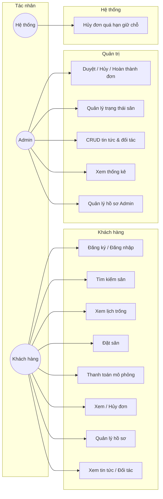
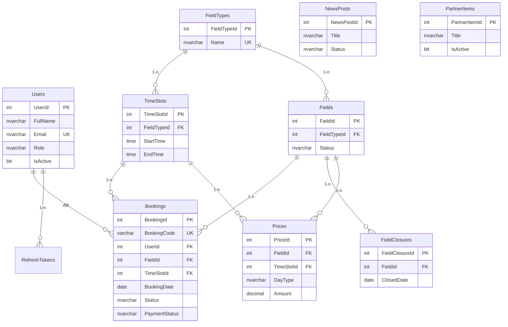
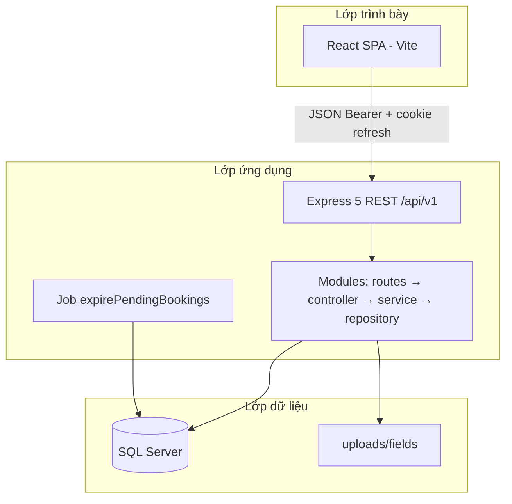
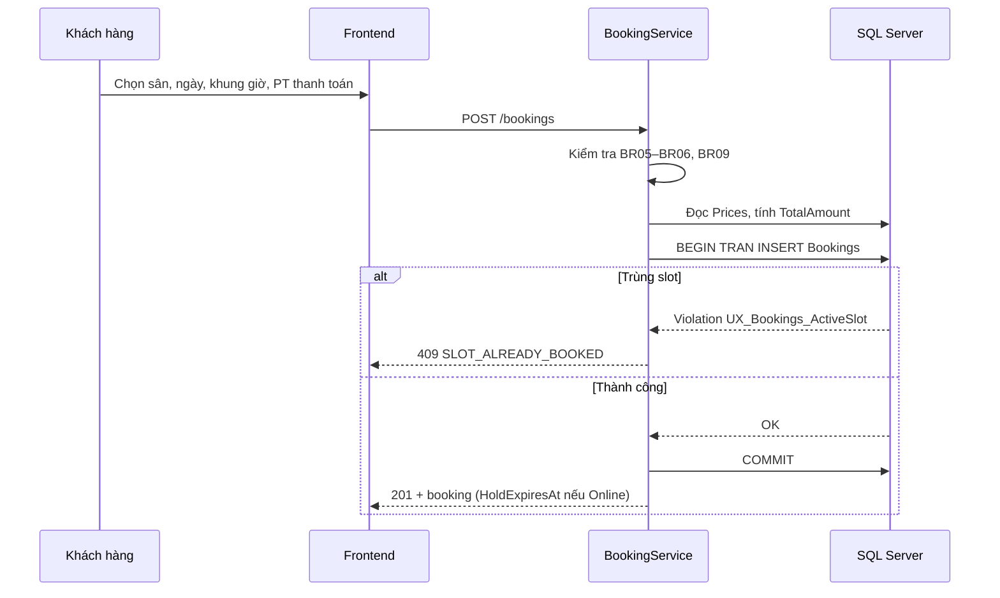
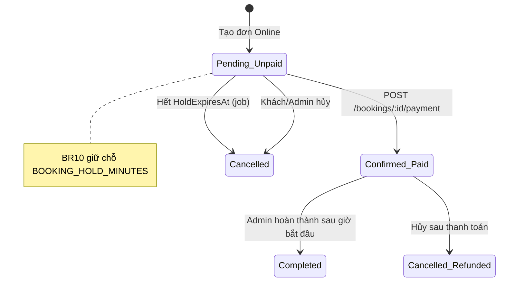
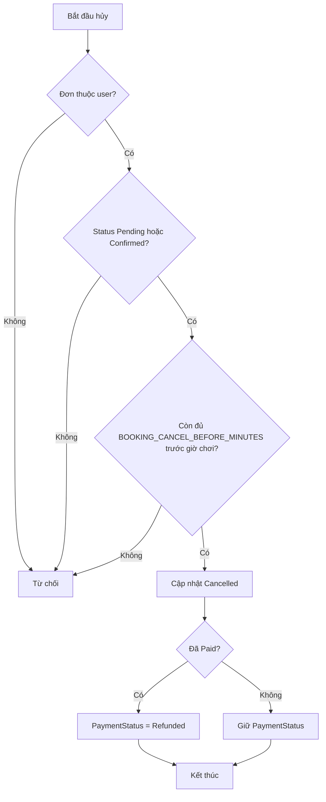

# CHƯƠNG 2 — PHÂN TÍCH VÀ THIẾT KẾ HỆ THỐNG

**Đề tài:** Website đặt sân thể thao trực tuyến và quản lý lịch sân  
**Sinh viên:** Hà Thế Hưng — MSSV 211211680 — CNTT5 K62  
**Giảng viên hướng dẫn:** ThS. Đinh Công Tùng  
**Trường:** Đại học Giao thông Vận tải (UTC)

---

## 2.1. Giới thiệu chương

Chương 2 trình bày quá trình khảo sát, phân tích yêu cầu và thiết kế tổng thể cho hệ thống **đặt sân thể thao trực tuyến**. Nội dung gồm: mục tiêu và phạm vi, yêu cầu chức năng và phi chức năng, mô hình use case, thiết kế cơ sở dữ liệu (ERD), kiến trúc phần mềm, các luồng nghiệp vụ cốt lõi (đặt sân, thanh toán mô phỏng, hủy đơn) và stack công nghệ đã chốt cho giai đoạn triển khai.

Tài liệu này bám sát mã nguồn và migration trong repository (`database/migrations/`, `STRUCTURE.md`, `.cursor/rules/20-business-rules.mdc`).

---

## 2.2. Khảo sát và mục tiêu hệ thống

### 2.2.1. Bài toán thực tế

Chủ sân và người chơi thường gặp khó khăn khi đặt lịch qua điện thoại hoặc sổ tay: trùng khung giờ, thiếu minh bạch giá và trạng thái sân, khó tra cứu lịch sử. Hệ thống web tập trung hóa **tra cứu sân — xem lịch trống — đặt chỗ — thanh toán (mô phỏng) — quản trị đơn và nội dung website**.

### 2.2.2. Mục tiêu

| Mục tiêu | Mô tả |
|----------|--------|
| MT1 | Cung cấp giao diện khách hàng đặt sân theo loại sân, ngày và khung giờ, có bảng trạng thái lịch trực quan. |
| MT2 | RESTful API bảo mật (JWT), chống đặt trùng ở tầng CSDL và nghiệp vụ. |
| MT3 | Quản trị viên duyệt/hủy/hoàn thành đơn, quản lý trạng thái sân, tin tức và đối tác. |
| MT4 | Thống kê số đơn và doanh thu phục vụ vận hành. |

### 2.2.3. Phạm vi giai đoạn thiết kế (Chương 2)

- **Trong phạm vi:** mô hình dữ liệu 10 bảng (8 lõi + 2 nội dung), use case khách hàng và admin, luồng đặt/thanh toán/hủy, kiến trúc 3 lớp (Presentation — Application — Data).
- **Ngoài phạm vi thiết kế chi tiết (các chương sau):** tích hợp cổng thanh toán thật, ứng dụng di động native, đa chi nhánh phức tạp.

---

## 2.3. Phân tích yêu cầu

### 2.3.1. Tác nhân (Actor)

| Actor | Mô tả |
|-------|--------|
| **Khách hàng (Customer)** | Đăng ký/đăng nhập, tìm sân, xem lịch, đặt sân, thanh toán mô phỏng, xem/hủy đơn của mình, quản lý hồ sơ. |
| **Quản trị viên (Admin)** | Toàn quyền vận hành: duyệt đơn, cập nhật trạng thái sân, CRUD tin tức/đối tác, xem thống kê; có hồ sơ và lịch sử đặt lịch hệ thống. |
| **Hệ thống (System)** | Job nền hủy đơn Online quá hạn giữ chỗ (`expirePendingBookings`). |

### 2.3.2. Yêu cầu chức năng (tóm tắt)

| Mã | Nhóm | Yêu cầu |
|----|------|---------|
| FC01 | Xác thực | Đăng ký, đăng nhập, refresh token, đăng xuất, `/auth/me`. |
| FC02 | Sân & lịch | Danh sách/ lọc sân; lịch theo sân hoặc bảng theo loại sân + ngày; hiển thị ô trống/đã đặt/bảo trì/đã qua. |
| FC03 | Đặt sân | Tạo đơn với thông tin khách, phương thức thanh toán; server tính giá; chống trùng slot. |
| FC04 | Thanh toán | Mô phỏng Online (giữ chỗ có thời hạn); PayAtField (xác nhận tại quầy qua Admin). |
| FC05 | Hủy đơn | Khách hủy trong điều kiện BR12; Admin chuyển trạng thái theo BR13. |
| FC06 | Quản trị | Quản lý đơn, sân (trạng thái), tin tức, đối tác; thống kê tổng quan/doanh thu/hiệu suất sân (API). |
| FC07 | Nội dung | Trang tin tức và đối tác đọc từ CSDL (`NewsPosts`, `PartnerItems`). |

### 2.3.3. Yêu cầu phi chức năng

| Mã | Yêu cầu | Cách đáp ứng thiết kế |
|----|---------|------------------------|
| NFR01 | Bảo mật | JWT access token; refresh token HTTP-only cookie; bcrypt mật khẩu; phân quyền role. |
| NFR02 | Hiệu năng | Pool kết nối SQL Server; index tra cứu; phân trang API. |
| NFR03 | Toàn vẹn dữ liệu | FK, CHECK, unique index `UX_Bookings_ActiveSlot`; transaction khi đặt sân. |
| NFR04 | Khả dụng | Thông báo lỗi chuẩn `{ success, error }`; múi giờ nghiệp vụ `Asia/Ho_Chi_Minh`. |
| NFR05 | Bảo trì | Module hóa backend; `STRUCTURE.md` làm nguồn sự thật kiến trúc. |

---

## 2.4. Mô hình Use Case

### 2.4.1. Sơ đồ Use Case tổng quát

### 2.4.2. Mô tả Use Case tiêu biểu

**UC-04 — Đặt sân**

| Hạng mục | Nội dung |
|----------|----------|
| Tác nhân chính | Khách hàng (đã đăng nhập) |
| Tiền điều kiện | Sân Active, có giá cho (sân, khung giờ, loại ngày), slot chưa bị đặt, không thuộc ngày nghỉ sân |
| Luồng chính | 1) Chọn loại sân, ngày, sân, khung giờ. 2) Nhập thông tin liên hệ và PT thanh toán. 3) Hệ thống tính `TotalAmount`, tạo đơn `Pending`. 4) Trả mã đơn và (nếu Online) thời hạn giữ chỗ. |
| Luồng thay thế | Slot vừa bị đặt → 409 `SLOT_ALREADY_BOOKED`. Vượt số đơn Pending chưa trả → từ chối theo BR09. |
| Hậu điều kiện | Bản ghi `Bookings` được tạo; lịch hiển thị ô đã đặt. |

**UC-09 — Admin duyệt đơn**

| Hạng mục | Nội dung |
|----------|----------|
| Tác nhân | Admin |
| Luồng chính | Admin chọn đơn `Pending` → chuyển `Confirmed` (Online thường đã Paid trước đó; PayAtField có thể Unpaid đến khi hoàn thành). |
| Ràng buộc | Chỉ chuyển trạng thái theo bảng BR13; cập nhật có điều kiện `Status` hiện tại (BR14). |

---

## 2.5. Thiết kế cơ sở dữ liệu

### 2.5.1. Quy ước

- Timestamp hệ thống (`CreatedAt`, `PaidAt`, `HoldExpiresAt`, …): **UTC** (ISO 8601 khi trả API).
- `BookingDate`, `StartTime`, `EndTime`: theo **giờ Việt Nam** (`APP_TIMEZONE=Asia/Ho_Chi_Minh`).
- Script khởi tạo: `database/migrations/001_init_schema.sql`, mở rộng nội dung: `002_site_content.sql`.

### 2.5.2. ERD (mô hình quan hệ)

*Bảng `NewsPosts` và `PartnerItems` độc lập phục vụ CMS, không FK sang Bookings.*

### 2.5.3. Ràng buộc nghiệp vụ quan trọng trên CSDL

| Ràng buộc | Ý nghĩa |
|-----------|---------|
| `UX_Bookings_ActiveSlot` | Unique `(FieldId, TimeSlotId, BookingDate)` WHERE `Status <> Cancelled` — nền tảng chống trùng lịch (BR07). |
| `UQ_Prices_Field_Slot_Day` | Một mức giá duy nhất cho tổ hợp sân + khung giờ + Weekday/Weekend (BR03). |
| `UQ_TimeSlots_Type_Range` | Khung giờ không trùng trên cùng loại sân (BR02). |

### 2.5.4. Bảng tóm tắt thực thể

| Bảng | Vai trò |
|------|---------|
| Users, RefreshTokens | Tài khoản và phiên đăng nhập |
| FieldTypes, Fields, TimeSlots, Prices, FieldClosures | Danh mục sân, giá, ngày nghỉ |
| Bookings | Đơn đặt sân — trung tâm nghiệp vụ |
| NewsPosts, PartnerItems | Nội dung trang Tin tức / Đối tác |

---

## 2.6. Kiến trúc hệ thống

### 2.6.1. Kiến trúc logic (3 lớp)

### 2.6.2. Triển khai môi trường phát triển

- Frontend `localhost:5173`, proxy `/api` và `/uploads` → backend `localhost:5000` (cùng origin logic cho cookie refresh).
- Production (thiết kế): Nginx phục vụ static build + reverse proxy API.

### 2.6.3. Phân rã module backend (theo nghiệp vụ)

Auth, Users, FieldTypes, Fields, TimeSlots, Prices, FieldClosures, Schedule, Bookings, Stats, NewsPosts, PartnerItems — mỗi module tách validation (Zod), service (quy tắc BR), repository (SQL tham số hóa).

---

## 2.7. Thiết kế luồng nghiệp vụ

### 2.7.1. Luồng đặt sân (tạo đơn)

### 2.7.2. Luồng thanh toán Online (mô phỏng)

### 2.7.3. Luồng hủy đơn (khách hàng)

### 2.7.4. Bảng chuyển trạng thái đơn (Admin — BR13)

| Trạng thái hiện tại | Chuyển được sang |
|--------------------|------------------|
| Pending | Confirmed, Cancelled |
| Confirmed | Completed, Cancelled |
| Completed | — (cuối) |
| Cancelled | — (cuối) |

*Completed chỉ khi đã đến giờ bắt đầu khung đặt.*

---

## 2.8. Công nghệ và tiêu chuẩn triển khai

| Tầng | Công nghệ |
|------|-----------|
| Frontend | JavaScript, React 18, Vite, React Router, Axios, TanStack Query, React Hook Form, Zod, Bootstrap 5 |
| Backend | Node.js, Express 5 (CommonJS), Zod validation, JWT, bcrypt, driver `mssql` |
| CSDL | Microsoft SQL Server |
| API | REST, prefix `/api/v1`, JSON |
| Tài liệu dự án | `STRUCTURE.md`, `.cursor/rules/`, migration/seed trong `database/` |

---

## 2.9. Ma trận ánh xạ yêu cầu — thiết kế — mã nguồn

| Yêu cầu | Thiết kế | Hiện thực (tham chiếu repo) |
|---------|----------|-----------------------------|
| FC03, BR07 | Unique index + transaction | `001_init_schema.sql`, `booking.service.js` |
| FC04, BR10 | HoldExpiresAt + job | `expirePendingBookings.js` |
| FC06 | Module stats, admin bookings | `stats/*`, `bookings/*` |
| FC07 | Bảng NewsPosts, PartnerItems | `002_site_content.sql`, modules `newsPosts`, `partnerItems` |
| NFR01 | JWT + refresh | `modules/auth/*`, `httpClient.js` |

---

## 2.10. Kết luận chương

Chương 2 đã hoàn tất các deliverable của **giai đoạn thiết kế hệ thống**: phân tích yêu cầu cho hai vai trò Khách hàng và Admin, mô hình use case, ERD mười thực thể (gồm nội dung website), kiến trúc ba lớp và luồng xử lý đặt sân — thanh toán mô phỏng — hủy đơn gắn với quy tắc nghiệp vụ BR01–BR16. Thiết kế được cụ thể hóa bằng script migration/seed và mô tả trong `STRUCTURE.md`, làm cơ sở cho các chương triển khai API, giao diện và kiểm thử tiếp theo.

---

*Tài liệu: `reportChap2.md` — ngang cấp `README.md`, cập nhật theo repository HTH_211211680_UTC.*
