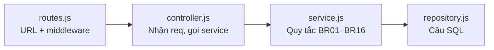
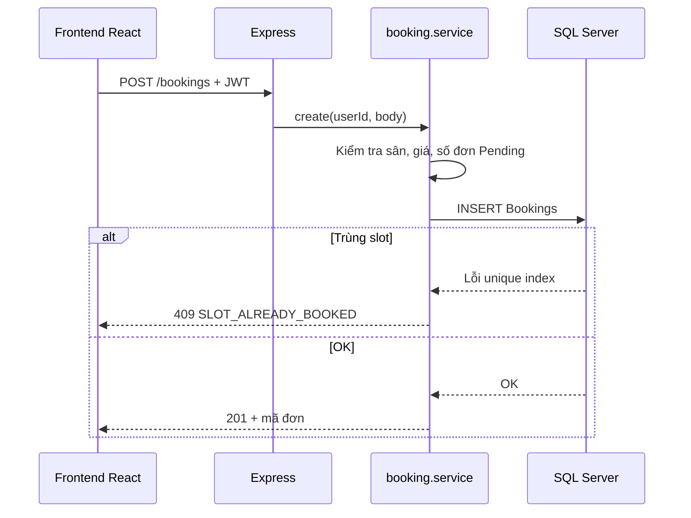

# CHƯƠNG 3 — XÂY DỰNG BACKEND VÀ CƠ SỞ DỮ LIỆU

**Đề tài:** Website đặt sân thể thao trực tuyến và quản lý lịch sân  
**Sinh viên:** Hà Thế Hưng — MSSV 211211680 — CNTT5 K62  
**Giảng viên hướng dẫn:** ThS. Đinh Công Tùng  

> Tài liệu này giải thích **phần Backend (máy chủ API)** đã được cài đặt trong dự án, viết cho người mới (intern) — **chưa cần biết sâu React hay Express**. Bạn chỉ cần hiểu: *ai gọi ai*, *file nào làm việc gì*, và *chạy dự án thế nào*.

---

## 3.1. Backend là gì? (trong 5 phút)

Hãy tưởng tượng **nhà hàng**:

| Vai trò | Trong dự án này |
|---------|------------------|
| **Khách** | Người dùng mở trang web (trình duyệt) |
| **Bồi bàn** | **Frontend** (React) — hiển thị nút bấm, form, bảng lịch |
| **Bếp + kho** | **Backend** (Node.js + Express) — xử lý quy tắc, tính tiền, lưu đơn |
| **Kho hàng** | **SQL Server** — nơi lưu user, sân, đơn đặt lịch |

**Node.js** = phần mềm giúp chạy JavaScript **trên máy chủ** (không phải trong trình duyệt).  
**Express** = thư viện giúp tạo **API** (các đường dẫn URL như `/api/v1/bookings`) để Frontend gọi qua mạng.

Frontend **không** được phép tự ý ghi vào database. Mọi thao tác đều đi qua Backend để kiểm tra quy tắc (còn sân không, trùng giờ không, đủ quyền không).

---

## 3.2. Công nghệ Backend đã chọn (và vì sao)

| Thành phần | Vai trò đơn giản |
|------------|------------------|
| **JavaScript (CommonJS)** | Ngôn ngữ lập trình chính thư mục `backend/` |
| **Express 5** | Nhận HTTP request (GET/POST/…), trả JSON |
| **SQL Server + driver `mssql`** | Kết nối và chạy câu lệnh SQL |
| **Zod** | Kiểm tra dữ liệu gửi lên (email đúng format, id là số, …) |
| **JWT + cookie refresh** | Đăng nhập: token ngắn hạn + cookie làm mới phiên |
| **bcrypt** | Mã hóa mật khẩu (không lưu plain text) |
| **Jest + Supertest** | Tự động kiểm tra code có chạy đúng không |

React **không nằm trong chương này** — React thuộc giao diện (Frontend). Chương 3 chỉ mô tả **API** mà React sẽ gọi.

---

## 3.3. Cây thư mục Backend (bạn cần nhớ chỗ nào)

```
backend/
├── .env                 ← MẬT (không commit): mật khẩu DB, JWT secret
├── .env.example         ← Mẫu để copy sang .env
├── package.json         ← Danh sách thư viện + lệnh npm run dev / test
├── scripts/
│   ├── migrate.js       ← Tạo bảng trong SQL Server
│   └── seed.js          ← Nạp dữ liệu mẫu + tài khoản Admin
├── src/
│   ├── server.js        ← Điểm vào: bật server, kết nối DB, chạy job nền
│   ├── app.js           ← Cấu hình Express (CORS, JSON, gắn routes)
│   ├── config/          ← env, logger, pool database
│   ├── constants/       ← Hằng số: Role, trạng thái đơn, mã lỗi
│   ├── middlewares/     ← Lớp “cửa”: auth, phân quyền, validate, xử lý lỗi
│   ├── utils/           ← Hàm dùng chung: ngày giờ VN, phân trang, AppError
│   ├── modules/         ← Từng nghiệp vụ (auth, bookings, fields, …)
│   ├── jobs/            ← Việc chạy nền (hủy đơn quá hạn giữ chỗ)
│   └── routes/index.js  ← Gom tất cả URL /api/v1/...
└── tests/               ← Unit test + integration test
```

**Quy tắc vàng:** Logic nghiệp vụ quan trọng nằm ở **`*.service.js`**, không nhét vào `routes`.

---

## 3.4. Kiến trúc 4 tầng trong mỗi module (workflow code)

Mỗi chức năng (ví dụ *đặt sân*) được chia **4 lớp** — giống dây chuyền sản xuất:



| Tầng | File thường gặp | Làm gì? |
|------|-----------------|--------|
| **Routes** | `booking.routes.js` | Khai báo `POST /bookings`, gắn `authenticate`, `validate` |
| **Controller** | `booking.controller.js` | Gọi `bookingService.create(...)`, trả JSON chuẩn |
| **Service** | `booking.service.js` | Kiểm tra sân Active, giá có chưa, giới hạn số đơn Pending, … |
| **Repository** | `booking.repository.js` | `INSERT`, `SELECT` — chỉ SQL, không if nghiệp vụ phức tạp |
| **Validation** | `booking.validation.js` | Schema Zod: body/query/params hợp lệ |

**Ví dụ luồng một request đặt sân:**

1. React gửi `POST /api/v1/bookings` kèm header `Authorization: Bearer <token>`.
2. `authenticate` đọc JWT → biết `userId`.
3. `validate` kiểm tra body (fieldId, timeSlotId, ngày, SĐT, …).
4. `controller` gọi `service.create(userId, body)`.
5. `service` kiểm tra BR05–BR09, tính tiền từ bảng `Prices`, gọi `repository.insert`.
6. Nếu trùng slot → SQL báo lỗi unique → service trả **409** `SLOT_ALREADY_BOOKED`.
7. `controller` trả `{ success: true, data: { ... } }`.

---

## 3.5. Cơ sở dữ liệu — tạo và nạp dữ liệu

### 3.5.1. Migration (tạo bảng)

- File: `database/migrations/001_init_schema.sql` — 8 bảng lõi (Users, Fields, Bookings, …).
- File: `database/migrations/002_site_content.sql` — tin tức & đối tác.
- Chạy: `cd backend` → `npm run db:migrate`  
  Script `scripts/migrate.js` ghi lại migration đã chạy (tránh chạy trùng).

### 3.5.2. Seed (dữ liệu mẫu)

- `database/seeds/001_master_data.sql` — loại sân, khung giờ, sân, giá.
- `002_site_content.sql`, `003_admin_profile.sql` — tin/đối tác, hồ sơ Admin đồ án.
- Chạy: `npm run db:seed`  
  Tạo Admin từ biến `ADMIN_EMAIL`, `ADMIN_PASSWORD` trong `.env`.

### 3.5.3. Bảng quan trọng nhất với đặt sân

- **`Bookings`**: mỗi dòng = một lần đặt (sân + khung giờ + ngày).
- **Index `UX_Bookings_ActiveSlot`**: không cho 2 đơn *chưa hủy* cùng sân + cùng giờ + cùng ngày (chống trùng).

Chi tiết ERD xem **Chương 2** (`reportChap2.md`).

---

## 3.6. Cấu hình môi trường (`.env`)

Copy `backend/.env.example` → `backend/.env`, chỉnh tối thiểu:

| Biến | Ý nghĩa |
|------|---------|
| `DB_SERVER`, `DB_NAME`, `DB_USER`, `DB_PASSWORD` | Kết nối SQL Server |
| `JWT_ACCESS_SECRET` | Chuỗi bí mật ≥ 32 ký tự để ký token |
| `ADMIN_EMAIL`, `ADMIN_PASSWORD` | Tài khoản Admin khi seed |
| `BOOKING_HOLD_MINUTES` | Số phút giữ chỗ khi thanh toán Online |
| `APP_TIMEZONE` | `Asia/Ho_Chi_Minh` |

File `src/config/env.js` đọc `.env` và **validate** bằng Zod — thiếu/sai → server không chạy (tránh lỗi khó debug).

---

## 3.7. Khởi động server (workflow vận hành)

```powershell
cd backend
npm install
npm run db:migrate
npm run db:seed
npm run dev
```

**`server.js` làm lần lượt:**

1. `getPool()` — mở pool kết nối SQL Server.
2. `startExpirePendingBookingsJob()` — mỗi phút quét đơn Online hết hạn giữ chỗ → hủy.
3. `app.listen(5000)` — lắng nghe HTTP.
4. Khi tắt (Ctrl+C): đóng job, đóng pool.

**`app.js`:** bật bảo mật cơ bản (helmet, cors), parse JSON, mount `/api/v1`, cuối cùng là `errorHandler` (mọi lỗi ra JSON thống nhất).

Kiểm tra sống: mở `GET http://localhost:5000/api/v1/health` → `{ success: true, data: { status: "ok", database: "up" } }`.

---

## 3.8. Danh sách module API đã cài đặt

Tất cả prefix: **`/api/v1`**. Bảng dưới là “menu” API — Frontend gọi đúng path này.

| Module | Thư mục | Chức năng chính |
|--------|---------|-----------------|
| Auth | `modules/auth/` | register, login, refresh, logout, me |
| Users | `modules/users/` | Hồ sơ, đổi mật khẩu; Admin quản lý user |
| FieldTypes | `modules/fieldTypes/` | Loại sân (bóng đá, cầu lông, …) |
| Fields | `modules/fields/` | CRUD sân, upload ảnh, tìm kiếm |
| TimeSlots | `modules/timeSlots/` | Khung giờ theo loại sân |
| Prices | `modules/prices/` | Giá theo sân × khung giờ × ngày thường/cuối tuần |
| FieldClosures | `modules/fieldClosures/` | Ngày sân nghỉ |
| Schedule | `modules/schedule/` | Lịch 1 sân / bảng nhiều sân theo ngày |
| Bookings | `modules/bookings/` | Đặt sân, thanh toán mô phỏng, hủy, Admin duyệt |
| Stats | `modules/stats/` | Tổng quan, doanh thu, hiệu suất sân |
| NewsPosts | `modules/newsPosts/` | CRUD tin tức |
| PartnerItems | `modules/partnerItems/` | CRUD đối tác |

Mount tại: `src/routes/index.js`.

---

## 3.9. Xác thực & phân quyền (dễ hiểu)

### 3.9.1. Đăng nhập trả về gì?

- **Access token (JWT)** — sống ~15 phút, Frontend giữ trong bộ nhớ (`tokenStore.js`).
- **Refresh token** — nằm trong **cookie httpOnly**, dùng để lấy access token mới khi hết hạn.

### 3.9.2. Middleware

| Middleware | Ý nghĩa |
|------------|---------|
| `authenticate` | Có JWT hợp lệ không? Gắn `req.user`. |
| `authorize('Admin')` | User có role Admin không? |
| `validate({ body, query })` | Dữ liệu đúng schema Zod không? |

Route **public** (không login): ví dụ `GET /fields`, `GET /news-posts`.  
Route **Customer**: `POST /bookings`, `GET /bookings/me`.  
Route **Admin**: `GET /bookings`, `PATCH /bookings/:id/status`.

---

## 3.10. Workflow nghiệp vụ cốt lõi (Backend xử lý)

### 3.10.1. Đặt sân + chống trùng



### 3.10.2. Thanh toán Online (mô phỏng)

- Tạo đơn: `Pending` + `Unpaid` + `HoldExpiresAt` (hết hạn sau X phút).
- Khách gọi `POST /bookings/:id/payment` → `Confirmed` + `Paid`.
- Nếu quá hạn: job nền → `Cancelled`.

### 3.10.3. Hủy đơn (khách)

- Chỉ đơn `Pending` hoặc `Confirmed`.
- Phải hủy **trước giờ chơi** ít nhất `BOOKING_CANCEL_BEFORE_MINUTES` phút.
- Đã trả tiền → `PaymentStatus` thành `Refunded`.

### 3.10.4. Admin duyệt đơn

- `PATCH /bookings/:id/status` với body `{ status: "Confirmed" | "Completed" | "Cancelled" }`.
- Chỉ chuyển theo bảng BR13 (xem `reportChap2.md`).

---

## 3.11. Định dạng JSON trả về (Frontend đọc thế này)

**Thành công:**

```json
{
  "success": true,
  "data": { },
  "meta": { "page": 1, "limit": 20, "total": 100 }
}
```

**Lỗi:**

```json
{
  "success": false,
  "error": {
    "code": "SLOT_ALREADY_BOOKED",
    "message": "Khung giờ này đã được đặt"
  }
}
```

Hàm helper: `src/utils/response.js` (`ok`, `created`, `noContent`).

---

## 3.12. Frontend gọi Backend thế nào? (liên kết ngắn, không học React ở đây)

- Dev: React chạy `localhost:5173`, cấu hình **proxy** trong `frontend/vite.config.js` — mọi request `/api/...` được chuyển sang `localhost:5000`.
- File `frontend/src/api/httpClient.js`: Axios + tự gắn `Authorization` + tự refresh khi 401.

Bạn chỉ cần nhớ: **một chức năng trên web = một (hoặc vài) lệnh gọi API** tương ứng trong bảng mục 3.8.

---

## 3.13. Kiểm thử Backend (Giai đoạn 3 đã làm)

| Loại | File | Mục đích |
|------|------|----------|
| Unit | `tests/unit/booking.service.test.js` | Mock DB, test logic đặt/hủy/Admin |
| Unit | `tests/unit/datetime.test.js`, `token.test.js`, … | Hàm tiện ích |
| Integration | `tests/integration/bookings.test.js` | Gọi API thật + SQL Server: trùng slot 409, hủy đơn |
| Integration | `tests/integration/auth.test.js` | Login Admin |

Chạy (cần DB đã migrate/seed):

```powershell
cd backend
npm test
npm run lint
```

---

## 3.14. Những việc **không** thuộc Backend (tránh nhầm)

| Việc | Nằm ở đâu |
|------|-----------|
| Giao diện nút, màu, layout | `frontend/` (React) |
| Routing trang `/booking`, `/admin` | `frontend/src/app/router.jsx` |
| SQL tạo bảng | `database/migrations/` (chạy bằng script, không phải Express) |

---

## 3.15. Kết luận chương 3

Chương 3 đã **triển khai xong Backend RESTful** cho website đặt sân: kết nối SQL Server, 12 nhóm module nghiệp vụ, quy tắc đặt/hủy/thanh toán tại tầng service, job hủy đơn quá hạn, và bộ test tự động. Kiến trúc **routes → controller → service → repository** giúp code dễ đọc và bảo trì. Frontend (React) ở chương tiếp theo chỉ việc **gọi API** và hiển thị kết quả cho người dùng.

---

## Phụ lục A — Lệnh thường dùng (cheat sheet)

| Lệnh | Ý nghĩa |
|------|---------|
| `npm run dev` | Chạy API, tự reload khi sửa code |
| `npm run db:migrate` | Cập nhật cấu trúc bảng |
| `npm run db:seed` | Nạp dữ liệu mẫu |
| `npm test` | Chạy kiểm thử |
| `npm run lint` | Kiểm tra style/lỗi cơ bản ESLint |

## Phụ lục B — Đọc code theo thứ tự gợi ý (intern)

1. `server.js` → `app.js` → `routes/index.js`
2. `modules/auth/auth.routes.js` → `auth.service.js` (hiểu login)
3. `modules/bookings/booking.routes.js` → `booking.service.js` (hiểu đặt sân)
4. `middlewares/authenticate.js`, `middlewares/errorHandler.js`
5. Một file `*.repository.js` bất kỳ để xem SQL

---

*Tài liệu: `reportChap3.md` — ngang cấp `README.md` / `reportChap2.md`. Cập nhật theo nhánh `cursor/add-structure-doc-and-rules`.*
