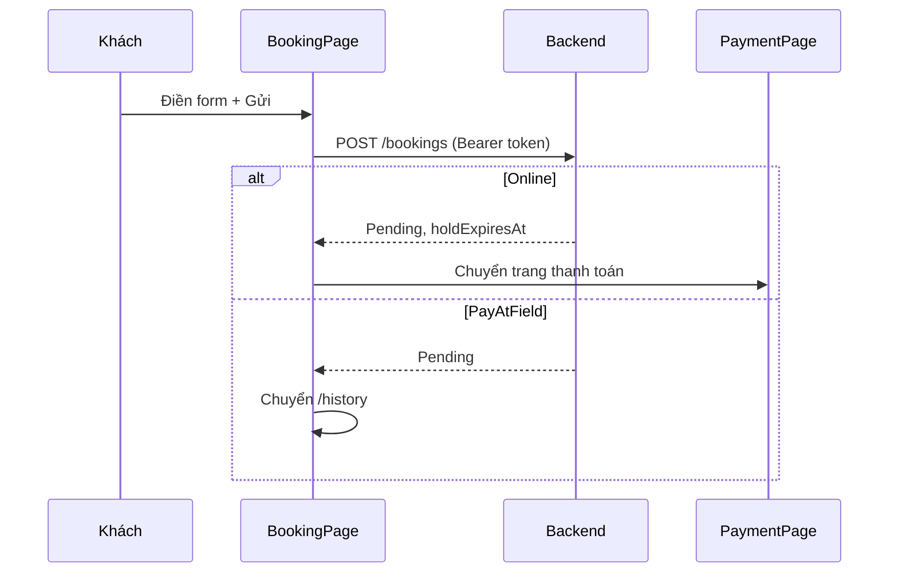
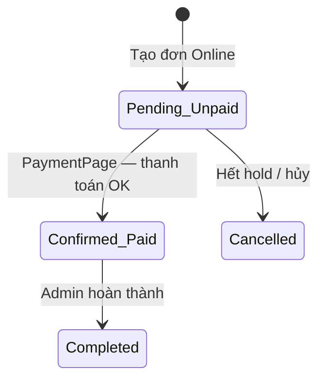

# CHƯƠNG 4 — TRIỂN KHAI GIAO DIỆN VÀ LUỒNG NGHIỆP VỤ CHÍNH

**Đề tài:** Website đặt sân thể thao trực tuyến và quản lý lịch sân  
**Sinh viên:** Hà Thế Hưng — MSSV 211211680 — CNTT5 K62  
**Giảng viên hướng dẫn:** ThS. Đinh Công Tùng  
**Trường:** Đại học Giao thông Vận tải (UTC)

> Tài liệu này mô tả **phần Frontend (React)** và cách các màn hình **kết nối với API** để thực hiện luồng: *khách đặt sân → thanh toán → hủy đơn → admin xử lý đơn*. Nội dung viết theo góc nhìn **sinh viên thực tập (intern)**: giải thích *file nào làm gì*, *dữ liệu đi từ đâu đến đâu*, không đi sâu vào tối ưu hệ thống lớn.

---

## 4.1. Giới thiệu chương

Sau khi hoàn thành thiết kế (Chương 2) và xây dựng Backend/API (Chương 3), em triển khai **giao diện người dùng** bằng **ReactJS 18** và **Vite**. Hệ thống có hai “mặt”:

| Mặt giao diện | Đối tượng | Mục đích chính |
|---------------|-----------|----------------|
| **Trang khách hàng** | Role `Customer` | Tìm sân, xem lịch trống/đã đặt, đặt sân, thanh toán mô phỏng, xem lịch sử và hủy đơn |
| **Trang quản trị** | Role `Admin` | Duyệt/hủy/hoàn thành đơn, quản lý sân và giá, quản lý tin tức/đối tác, xem thống kê tổng quan |

Nguyên tắc em tuân theo trong code: **logic nghiệp vụ quan trọng nằm ở Backend**; Frontend chỉ hiển thị, thu thập input và gọi API. Frontend **không** tự tính tiền hay quyết định có được đặt trùng giờ hay không — server trả lỗi (ví dụ `409 SLOT_ALREADY_BOOKED`) thì giao diện hiển thị thông báo tiếng Việt.

---

## 4.2. Công nghệ Frontend đã sử dụng

| Thư viện / công cụ | Vai trò trong dự án |
|--------------------|---------------------|
| **React 18** | Xây dựng giao diện theo **component** (khối UI tái sử dụng) |
| **Vite** | Công cụ dev/build nhanh; proxy `/api` và `/uploads` sang Backend khi chạy local |
| **React Router v6** | Điều hướng URL (trang chủ, đặt sân, admin, …) |
| **Axios** (`httpClient.js`) | Gọi REST API `/api/v1`, gắn JWT, tự **refresh token** khi 401 |
| **TanStack Query** | Quản lý **tải dữ liệu từ server** (cache, loading, lỗi, làm mới sau khi gửi form) |
| **React Hook Form + Zod** | Form đặt sân, đăng nhập: validate phía client trước khi gọi API |
| **Bootstrap 5** | Layout, bảng, nút, form — bám template thiết kế (`frontend/template/`) |

**Vì sao tách `*.api.js` và `*.hooks.js`?**  
- `*.api.js`: chỉ biết **gọi HTTP** (GET/POST/PATCH).  
- `*.hooks.js`: bọc API bằng `useQuery` / `useMutation` để page không phải tự viết `useEffect` + `useState` cho từng request.

---

## 4.3. Cấu trúc thư mục Frontend (theo feature)

```
frontend/src/
├── app/              App.jsx, router.jsx, queryClient.js
├── api/              httpClient.js, tokenStore.js
├── features/         Mỗi nghiệp vụ một thư mục (auth, bookings, fields, schedule, …)
├── pages/            Trang ghép sẵn: client/, admin/, auth/
├── components/       Header, Footer, UI dùng chung
├── layouts/          ClientLayout, AdminLayout, AuthLayout
├── constants/        routes.js, nhãn trạng thái đơn, queryKeys
└── utils/            format tiền/ngày, getErrorMessage
```

**Quy ước em áp dụng (theo `.cursor/rules/30-frontend.mdc`):**

1. **Page** (`pages/...`): ghép layout + hook + component con; **không** gọi axios trực tiếp.  
2. **Feature** (`features/<tên>/`): `*.api.js` + `*.hooks.js` + `components/` (nếu có).  
3. **Component dùng chung** (`components/`): không chứa quy tắc nghiệp vụ.

Ví dụ luồng đặt sân:

```
BookingPage.jsx  →  useCreateBooking()  →  createBookingApi()  →  POST /bookings
                 →  useScheduleBoard()  →  GET /schedule
                 →  ScheduleStatusBoard.jsx (chỉ hiển thị bảng)
```

---

## 4.4. Khởi tạo ứng dụng và điều hướng

### 4.4.1. Điểm vào `App.jsx`

Ứng dụng bọc ba lớp provider:

1. `QueryClientProvider` — TanStack Query toàn cục.  
2. `AuthProvider` — trạng thái đăng nhập (`user`, `login`, `logout`).  
3. `RouterProvider` — bảng route trong `router.jsx`.

### 4.4.2. Bảng route chính

| URL (ví dụ) | Trang | Ghi chú |
|-------------|-------|---------|
| `/` | `HomePage` | Trang chủ |
| `/booking` | `BookingPage` | Phiếu đặt sân + bảng trạng thái |
| `/search` | `SearchFieldsPage` | Tìm sân theo tên/loại (ngày trên UI) |
| `/history` | `MyBookingsPage` | Lịch sử đơn (cần đăng nhập) |
| `/payment/:bookingId` | `PaymentPage` | Thanh toán mô phỏng Online |
| `/login`, `/register` | Auth | Form đăng nhập/đăng ký |
| `/admin` | `AdminDashboard` | Chỉ role `Admin` |
| `/admin/operations/bookings` | `AdminBookingsPage` | Duyệt/hủy/hoàn thành đơn |
| `/admin/operations/fields` | `AdminFieldsPage` | Quản lý sân và bảng giá |

**Lazy load:** các page được `import()` động trong `router.jsx` để bundle ban đầu nhẹ hơn; khi chuyển trang hiện spinner “Đang tải trang”.

### 4.4.3. Bảo vệ route — `ProtectedRoute`

- Trang `/history`, `/payment/...`, `/profile`: bọc `ProtectedRoute` — chưa đăng nhập thì chuyển về `/login`.  
- Cây `/admin/*`: `ProtectedRoute roles={['Admin']}` — user `Customer` không vào được.

Access token lưu **trong RAM** (`tokenStore.js`), không lưu `localStorage` (giảm rủi ro XSS). Refresh token nằm trong **cookie httpOnly** do Backend set.

---

## 4.5. Cách React “tách component” và xử lý dữ liệu

### 4.5.1. Ba tầng trong feature `bookings`

| Tầng | File ví dụ | Trách nhiệm |
|------|------------|-------------|
| API | `bookings.api.js` | `createBookingApi`, `payBookingApi`, `cancelBookingApi`, … |
| Hook | `bookings.hooks.js` | `useCreateBooking`, `usePayBooking`, `useCancelBooking`, `useMyBookings` |
| UI | `ScheduleStatusBoard.jsx` | Nhận `boardQuery` từ cha, render bảng trống/đã đặt |

Sau mỗi **mutation** thành công (tạo đơn, thanh toán, hủy), hook gọi `queryClient.invalidateQueries` cho key `bookings` và `schedule` để **bảng lịch và danh sách đơn tự cập nhật** mà không cần F5.

### 4.5.2. Form đặt sân — `BookingPage.jsx`

- **React Hook Form** quản lý input: sân, khung giờ, ngày, tên/SĐT, ghi chú, phương thức thanh toán.  
- **Zod** (`createBookingSchema`) kiểm tra bắt buộc chọn sân, khung giờ, SĐT hợp lệ.  
- Khi đổi **loại sân**, page reset `fieldId` và `timeSlotId` (vì danh sách sân/giờ phụ thuộc loại).  
- Ngày trên form đồng bộ với ngày trên **bảng trạng thái** (`boardDate`).

**Component con quan trọng:** `ScheduleStatusBoard` — nhận props `fieldTypes`, `fieldTypeId`, `date`, callbacks; hiển thị legend “Còn trống / Đã đặt / Bảo trì”. Page cha gọi `useScheduleBoard(fieldTypeId, boardDate)` để lấy dữ liệu.

### 4.5.3. Trạng thái loading / lỗi / rỗng

Em cố gắng mỗi trang có đủ ba trạng thái, ví dụ `ScheduleStatusBoard`:

- Chưa chọn loại sân + ngày → thông báo hướng dẫn.  
- `isLoading` → spinner.  
- `isError` → thông báo lỗi tiếng Việt.  
- Không có khung giờ → “Không có khung giờ cho loại sân này”.

Lỗi API đọc qua `getErrorMessage(error)` — lấy `error.response.data.error.message` do Backend chuẩn hóa.

---

## 4.6. Danh mục chức năng đã hiện thực trên giao diện

### 4.6.1. Khách hàng

| Chức năng | Trang / component | API liên quan |
|-----------|-------------------|---------------|
| Đăng ký / đăng nhập / đăng xuất | `RegisterPage`, `LoginPage`, `AuthContext` | `/auth/register`, `/auth/login`, `/auth/logout`, `/auth/me` |
| Xem bảng lịch trống–đã đặt | `BookingPage` + `ScheduleStatusBoard` | `GET /schedule?fieldTypeId=&date=` |
| Đặt sân trực tuyến | `BookingPage` | `POST /bookings` |
| Thanh toán Online (mô phỏng) | `PaymentPage` | `POST /bookings/:id/payment` |
| Thanh toán tại sân | Chọn `PayAtField` trên form → sau tạo đơn vào `/history` | Tạo đơn `Pending`; Admin xác nhận sau |
| Lịch sử đơn, lọc trạng thái | `MyBookingsPage` | `GET /bookings/me` |
| Hủy đơn (trước giờ sử dụng, theo BR12) | Nút Hủy trên `MyBookingsPage` | `PATCH /bookings/:id/cancel` |
| Tìm sân (tên, loại) | `SearchFieldsPage` | `GET /fields?keyword=&fieldTypeId=` |
| Hồ sơ, đổi mật khẩu | `ProfilePage` | `/users/me`, `/users/me/password` |
| Tin tức, đối tác, liên hệ | `NewsPage`, `PartnersPage`, `ContactPage` | `/news-posts`, `/partner-items` |

### 4.6.2. Quản trị viên

| Chức năng | Trang | API liên quan |
|-----------|-------|---------------|
| Tổng quan (đơn chờ, doanh thu) | `AdminDashboard` | `GET /stats/overview` |
| Quản lý đơn: lọc, xác nhận, hủy, hoàn thành | `AdminBookingsPage` | `GET /bookings`, `PATCH /bookings/:id/status` |
| Workflow trạng thái đơn (tra cứu) | `AdminOrderStatusPage` | `GET /bookings/:id` |
| Quản lý sân: thêm/sửa/xóa, trạng thái, **bảng giá** | `AdminFieldsPage` | `/fields`, `PUT /fields/:id/prices` |
| CRUD tin tức, đối tác | `AdminNewsPage`, `AdminPartnersPage` | `/news-posts`, `/partner-items` |

**Ghi chú phạm vi (trung thực khi báo cáo):** API Backend đã hỗ trợ upload ảnh sân, CRUD khung giờ, ngày nghỉ sân, biểu đồ doanh thu chi tiết; một số mục **chưa có giao diện admin đầy đủ** hoặc chưa có biểu đồ (chỉ số liệu tổng trên dashboard). Em ghi rõ để thầy đánh giá đúng mức độ hoàn thiện.

---

## 4.7. Luồng nghiệp vụ chính — từ góc nhìn Frontend

Phần dưới mô tả **thứ tự thao tác người dùng** và **file React** tham gia. Quy tắc BR05–BR14 xử lý tại `booking.service.js` (Backend); Frontend phản ánh kết quả.

### 4.7.1. Luồng khách đặt sân

**Bước người dùng:**

1. Vào `/booking`.  
2. Chọn loại sân → form load danh sách sân và khung giờ (`useFields`, `useTimeSlots`).  
3. Xem bảng trạng thái theo ngày (`useScheduleBoard`).  
4. Chọn sân, khung giờ, ngày, điền thông tin, chọn **Online** hoặc **PayAtField**.  
5. Bấm gửi — nếu chưa login → chuyển `/login` (lưu `state.from` để quay lại).

**Bước kỹ thuật:**

```
BookingPage.onSubmit
  → useCreateBooking.mutateAsync(body)
  → POST /api/v1/bookings
  → Nếu Online + Unpaid: navigate(/payment/:id)
  → Nếu PayAtField: navigate(/history)
```

**Sơ đồ tuần tự (rút gọn):**



Nếu slot đã có người đặt, API trả **409** — `BookingPage` hiển thị message từ server.

### 4.7.2. Luồng thanh toán mô phỏng (Online)

**Điều kiện:** đơn `paymentMethod = Online`, `paymentStatus = Unpaid`, `status = Pending`.

1. Sau khi tạo đơn, `PaymentPage` gọi `useBookingDetail(bookingId)`.  
2. Hiển thị **đếm ngược** `holdExpiresAt` (hook `useHoldCountdown` — cập nhật mỗi giây).  
3. Khách bấm “Xác nhận thanh toán” → `usePayBooking` → `POST /bookings/:id/payment`.  
4. Thành công → điều hướng `/history`; trạng thái đơn **Confirmed**, thanh toán **Paid** (theo BR10).

Nếu hết giờ giữ chỗ, job Backend `expirePendingBookings` hủy đơn; khi khách vào lại trang thanh toán sẽ thấy trạng thái **Cancelled** (query tự refetch).

**Sơ đồ trạng thái (Online):**



### 4.7.3. Luồng khách hủy đơn

1. Vào `/history` — `useMyBookings` tải danh sách.  
2. Với đơn `Pending` hoặc `Confirmed`, hiện nút **Hủy**.  
3. Confirm dialog → `useCancelBooking` → `PATCH /bookings/:id/cancel` kèm lý do.  
4. Backend kiểm tra BR12 (còn đủ phút trước giờ chơi, đúng chủ đơn).  
5. Thành công → invalidate cache → bảng lịch trên `/booking` cập nhật ô “Còn trống”.

Frontend **không** tự tính “còn được hủy không” bằng logic phức tạp — nếu vi phạm BR12, API trả lỗi và `getErrorMessage` hiển thị.

### 4.7.4. Luồng admin xử lý đơn

**Trang `AdminBookingsPage`:**

1. Lọc theo trạng thái và ngày đặt (`fetchAllBookingsApi`).  
2. Với từng đơn, admin có thể:  
   - **Xác nhận** (`Pending` → `Confirmed`) — quan trọng với **PayAtField**.  
   - **Hủy** (`Cancelled`).  
   - **Hoàn thành** (`Confirmed` → `Completed`) — Frontend gọi `isBeforeSlotStart` để cảnh báo nếu chưa tới giờ chơi (hỗ trợ BR13).  
3. Mỗi thao tác dùng `useMutation` + `adminUpdateBookingStatusApi` → `PATCH /bookings/:id/status`.

**Trang `AdminFieldsPage`:** quản lý danh sách sân, modal chỉnh **giá theo khung giờ × ngày thường/cuối tuần** — dữ liệu giá dùng khi server tính `TotalAmount` lúc đặt (BR08).

**Trang `AdminDashboard`:** hiển thị số đơn chờ, tổng đơn, đơn hủy, doanh thu đã thu từ `GET /stats/overview`.

---

## 4.8. Kết nối Frontend — Backend trong môi trường dev

File `vite.config.js` cấu hình **proxy**:

- Request từ trình duyệt tới `/api/v1/...` được chuyển tiếp sang Backend (cùng origin → cookie refresh hoạt động).  
- Ảnh sân: `/uploads/...`.

Biến `VITE_API_BASE_URL` (mặc định `/api/v1`) trong `.env` frontend.

**Chạy thử (tóm tắt):**

1. SQL Server + `npm run db:migrate` và `db:seed` trong `backend/`.  
2. `npm run dev` backend (cổng theo `.env`).  
3. `npm run dev` frontend (Vite).  
4. Đăng nhập Admin từ tài khoản seed; đăng ký tài khoản Customer mới để test đặt sân.

---

## 4.9. Bài học khi tổ chức React theo feature (intern)

1. **Tách API khỏi UI** giúp sau này đổi Axios sang fetch hoặc thêm test dễ hơn.  
2. **TanStack Query** tránh lặp code loading/error và tự đồng bộ dữ liệu sau mutation — phù hợp bảng lịch và danh sách đơn.  
3. **Component presentational** (`ScheduleStatusBoard`) nhận data qua props → dễ đọc và tái sử dụng.  
4. **Không tin dữ liệu client** (giá tiền, trạng thái slot) làm “nguồn sự thật”; luôn hiển thị theo response API mới nhất.  
5. **ProtectedRoute + role Admin** chỉ che UI; bảo mật thật vẫn ở middleware `authorize` Backend.

---

## 4.10. Ma trận ánh xạ luồng — trang — file

| Luồng | Trang chính | Hook / API chính |
|-------|-------------|------------------|
| Đặt sân | `BookingPage.jsx` | `useCreateBooking`, `useScheduleBoard`, `useFields`, `useTimeSlots` |
| Thanh toán | `PaymentPage.jsx` | `useBookingDetail`, `usePayBooking` |
| Hủy đơn | `MyBookingsPage.jsx` | `useMyBookings`, `useCancelBooking` |
| Admin duyệt đơn | `AdminBookingsPage.jsx` | `fetchAllBookingsApi`, `adminUpdateBookingStatusApi` |
| Admin sân & giá | `AdminFieldsPage.jsx` | `fetchAdminFieldsApi`, `replaceFieldPricesApi` |

---

## 4.11. Kết luận chương

Chương 4 trình bày cách em triển khai **giao diện React** cho website đặt sân: tổ chức code theo **feature**, tách **page / hook / API / component**, và ghép nối với REST API để hoàn thiện bốn luồng cốt lõi **đặt sân — thanh toán mô phỏng — hủy đơn — quản trị đơn và sân**. Giao diện khách hàng đã cho phép trải nghiệm end-to-end; phần quản trị đáp ứng vận hành cơ bản và thống kê tổng quan, còn một số tính năng nâng cao (biểu đồ chi tiết, quản lý khung giờ/ảnh sân trên UI) sẽ là hướng hoàn thiện tiếp theo.

---

*Tài liệu bám sát mã nguồn thư mục `frontend/src/` và mô tả kiến trúc trong `STRUCTURE.md` (cập nhật giai đoạn 4–5).*
